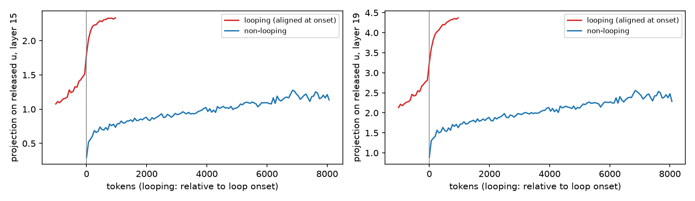

# unloop: the halting direction

Qwen3.5-0.8B, asked to think before it answers, often repeats itself until generation hits the token limit. A published weight edit removes most of these loops and raises accuracy on grade-school and competition math. The edit was produced by a frontier model. The public record is the edited checkpoint and a short formula ([Experiment 8](https://rikiyat.github.io/blog/weight-space-programming/)).

Arditi et al. (2024) showed that refusal is mediated by one direction, and that ablating the direction removes the refusal. Looping is a natural candidate for the same treatment. I ask whether I can recover the published edit with those tools. I also ask whether stopping the loop is what raises the accuracy.

In this study I reproduce the edit, compare it with difference-of-means ablation, activation steering, and decoding fixes, and train my own update on the same two matrices. The published edit raises held-out GSM8K from 12.8% to 68.7% and MATH-500 from 6.8% to 51.2%. My update brings the GSM8K loop rate down to 14.7%, near the published edit's 9.5%, and the accuracy in the table below stays well under the published row. Penalizing `</think>` on that stretch keeps the token rare, and the loop returns.

My claims are:

- The published checkpoint differs in two matrices. Each difference is a rank-one change on 64 columns, and a held-out rerun matches the reported gain.
- A difference-of-means direction separates looping text from the text before it. Deleting it at the two edited layers does nothing. Deleting it from every writer stops the loops. Accuracy stays near the base model.
- A teacher-forced probe that may lose at most 0.02 nats on ordinary text rejects the published edit.
- An edit trained to penalize repeated tokens learns a new direction. It ends loops, including from inside a loop, and the published accuracy does not come with it.
- Penalizing `</think>` on the loop stretch keeps that token at its base rate. From inside a loop the restarts are looping again, and I leave this edit off the full token limit.

## The edit

The *released edit* is the [published checkpoint](https://huggingface.co/RikiyaT/Qwen3.5-0.8B-weight-space-programming). I diff it against the original weights. Two tensors differ, both of them the MLP down-projections at layers 15 and 19. Each maps the MLP's neurons back into the residual stream. In each, 64 columns change, and the change has rank one. The second singular value is rounding noise (bfloat16).

The experiment logs state the update, and a least-squares fit recovers strength 6 on both layers ([lm_understand-logs](https://github.com/RikiyaT/lm_understand-logs), `exp8_math/`). Rebuilding the formula matches the stored weights up to rounding. `W0` is the original matrix, `u` is a unit vector in the residual stream, and the mask keeps those 64 columns.

```text
W = W0 - 6 * outer(u, mask * (u @ W0))
```

At strength 1 the same formula deletes the component of those columns along `u`. At the fitted strength the component changes sign and grows. Intuitively, those neurons are pushed back whenever they write along `u`, and the push is stronger than the write. The two layers agree on the direction. I keep this checkpoint as the control. Every other condition starts from the original weights.

## Setup

I score GSM8K and MATH with the blog's sampler (thinking on, at the blog's temperature, nucleus, top-k, and presence penalty) and the held-out split in `configs/full.toml`. I draw several samples per problem, out to the blog's token limit. Directions are fit on the blog's unedited traces of the other problems. Those problems do not enter the generation eval.

A response is looping when some suffix of at least 256 tokens is at least 90% repeated 16-grams. The loop onset is the start of the dense run inside that suffix. The first repeated token of the whole suffix sits several thousand tokens too early, because a suffix is allowed some slack and that slack reaches back into sparse repeats. I grade the last `\boxed{}` after the last `</think>`, or the whole response when thinking never closes, with math-verify 0.9.0.

I do not cut a generation when a detector fires. On the published edit's own MATH traces, a strict online repetition rule fires on traces that later finish (`results/reproduce.json`).

## A direction, and a probe that misses the edit

For each looping fit trace I read the residual stream of the base model. The productive window ends before onset and the loop window starts after it. Both are 256 tokens, with a 64-token gap between them. The direction at a layer is the mean residual in the loop window minus the mean in the productive window (paired inside the trace). At the two edited layers the paired effect size is about 2.7, and the cosine with the published direction is 0.68.

On a held-out slice of those traces I then score candidates by the change in next-token log probability. A candidate may lose at most 0.02 nats per token on the productive window. Under that cap the published edit is ineligible. The productive window falls by 0.06 nats, and the loop window falls by a similar amount. The eligible weight edit is an ablation of my direction at those two layers, and both windows hardly move. No steering scale I tried stays inside the cap.

This probe can miss an edit that acts once a loop is already going. I use it as a screen, and generation is the measurement below. The screen's chosen weight edit is the same spec as `dm_ablate_15_19`. I do not run a second copy of it.

## Held-out generation

Bold marks the published edit. Rates are percentages of generations. A cut generation hit the token limit. The first nine rows are vLLM and share the base row. The last four use the Hugging Face decoder, because they need a hook or a per-step logit bias, and their baseline is `base_hf`. Paired bootstrap intervals over problems are in `results/full/table.json`. For these rates the intervals run about two points wide.

| condition | key | GSM8K acc | GSM8K loop | GSM8K cut | MATH acc | MATH loop | MATH cut |
|---|---|---|---|---|---|---|---|
| base | `base` | 12.8 | 88.5 | 88.8 | 6.8 | 90.9 | 93.6 |
| ablate layers 15 and 19 | `dm_ablate_15_19` | 16.7 | 84.0 | 84.0 | 7.9 | 91.2 | 92.8 |
| my direction, published form | `dm_released_form` | 42.4 | 57.9 | 52.9 | 20.2 | 79.8 | 79.0 |
| ablate every writer | `dm_ablate_all_writers` | 15.2 | 6.7 | 4.9 | 8.8 | 9.6 | 5.3 |
| rank-1 edit | `rank1` | 38.6 | 14.7 | 12.2 | 16.4 | 39.3 | 33.2 |
| thinking budget 8,192 | `budget_8k` | 56.8 | 53.8 | 36.9 | 32.8 | 66.3 | 66.2 |
| thinking budget 16,384 | `budget_16k` | 57.5 | 85.6 | 36.2 | 33.3 | 84.6 | 65.2 |
| presence penalty 2.0 | `presence_2` | 19.5 | 80.6 | 80.9 | 9.8 | 87.1 | 90.5 |
| **published edit** | `released` | **68.7** | **9.5** | **7.2** | **51.2** | **26.7** | **30.2** |
| base, Hugging Face | `base_hf` | 13.1 | 87.7 | 88.1 | 5.2 | 92.8 | 95.2 |
| steer, layer 11, scale −2 | `steer_best` | 34.8 | 64.2 | 64.6 | 19.7 | 76.4 | 80.2 |
| `</think>` bias +4 | `think_bias_4` | 17.2 | 83.7 | 83.2 | 8.8 | 89.8 | 91.5 |
| `</think>` bias +8 | `think_bias_8` | 31.7 | 71.0 | 66.2 | 22.1 | 76.4 | 76.8 |

Ablating my direction at the two edited layers leaves accuracy and the loop rate next to the base row. This is the edit the probe selected. Writing that direction in the published form moves GSM8K part of the way and leaves most MATH traces looping.

Deleting the direction from every attention output and every MLP output does stop the loops, and the model finishes. Accuracy stays with the base model, and the answers are wrong.

On the Hugging Face rows, a bonus on the `</think>` logit recovers a slice of GSM8K and little of MATH. The steering row subtracts twice the layer-11 difference at every step, and it too recovers a slice. That hook is what an earlier sweep selected, before I corrected where the onset sits. Under the corrected sweep, no steering scale keeps the productive-window loss inside the cap above. Raising the presence penalty to the largest value vLLM accepts does not move the base row.

With the weights left alone, a short thinking budget recovers more GSM8K accuracy than any weight edit I fit, and most of those traces are looping. A scheduled stop could explain the budget's GSM8K accuracy and leave the MATH gap beside it. I believe the published edit is a different intervention. Its loop rate, and its MATH accuracy, sit in a different place from the budget rows.

## What the published direction does

The published direction grows when a loop starts. On the validation traces the residual's projection onto it jumps at the onset and stays high (`results/explain.json`). Finished traces from the edited model, read by the base model, lie lower across the whole response. The jump at the onset suggests the rise belongs to the loop.



Through the unembedding, this direction suppresses `</think>` (z-score near −2.5 at both edited layers). Removing the direction should help that token. Under the edited weights its loop-window log probability rises by about 7 nats, and it remains outside the sampler's shortlist almost everywhere. My difference-of-means direction does not pick the token out. The bias rows above are the direct test of a bonus on this logit, and they do not reproduce the edit.

## An edit trained on the loop

Because the probe refuses the published edit, I train the two matrices on the loop itself. I set `W` to `W + u v^T` at the two edited layers. The vector `u` starts as my difference-of-means direction and is kept a unit vector. The gain `v` starts near zero, with one entry per neuron. On each looping fit trace the loss is the next-token loss on the productive window, plus the unlikelihood of the repeated tokens over the following stretch of the loop. I add the same next-token loss on finished traces that are not looping. The fit uses 64 looping traces, 14 clean ones, and eight epochs. The published weights are not an input.

On held-out loops the unlikelihood falls from 8.7 to 0.16. Clean next-token loss hardly moves, and the pre-loop window gets somewhat worse. The learned direction is almost orthogonal to my difference-of-means direction and to the published direction (cosine near zero). A mask the size of the published one holds 6% of `v`, and restricting the edit to that mask returns the base loop rate on the restarts below.

I restart generation from the validation prefixes in `configs/branch_val.json` and stop at `</think>` (`results/branch_rank1.json`). A restart is looping when thinking never closes and the tail is a loop. Rates below are percentages. The base and published files are `results/branch_base.json` and `results/branch_released.json`.

| tokens from the loop start | base loop | published loop | published closes | rank-1 loop | rank-1 closes | rank-1, top 64, loop |
|---|---|---|---|---|---|---|
| −2,048 | 73.0 | 0.8 | 19.9 | 4.3 | 89.1 | 75.4 |
| −1,024 | 86.3 | 5.5 | 23.8 | 9.0 | 87.1 | 88.7 |
| −512 | 94.1 | 4.7 | 31.2 | 7.8 | 91.4 | 93.8 |
| −256 | 96.9 | 7.8 | 30.9 | 7.8 | 89.5 | 96.9 |
| 0 | 98.0 | 8.2 | 42.6 | 7.4 | 90.6 | 98.8 |
| +256 | 100 | 7.0 | 51.6 | 9.0 | 89.8 | 99.6 |

From inside the loop, my edit closes almost every restart, and the median close takes 14 new tokens. The trained write might be ending the trace rather than repairing it. The published edit closes about half of those restarts. Among the restarts that close, the median is 1,831 new tokens, and many restarts are neither closed nor looping when the budget ends. The same restarts with my direction in the published form behave like the base model (`results/branch_dm_released_form.json`).

On the full token limit the trained row is the one in the table above. Its traces are shorter than the published edit's, and far shorter than the base model's. Paired on the same problems, it trails the published edit by a wide margin on both benchmarks.

## Holding the end of thinking

The loss above counts a repeated token as a failure and any other token as a success. Blocking `</think>` on the loop stretch removes the early close described above.

Unlikelihood of `</think>` pushes back once the token is likely. While it is rare the term has no gradient, and a fit that uses this term alone matches the edit above, cosine 0.999. Giving the log probability an equal share of the update drives it to about −120 and lifts the pre-loop loss to 12. I report the training run that spends 2% of the update on this push (`results/rank1_hold.json`).

On held-out loops the repeat penalty falls as far as in the unpenalized fit, and the pre-loop loss rises about as much. The log probability of `</think>` stays at −30, where the earlier fit had moved it up. This vector leans toward the one from that fit at both layers. The published direction remains nearly orthogonal to the new one.

I restart the same prefixes and stop at `</think>`. The file is `results/branch_rank1_hold.json`. Each cell pools every sample of the validation traces.

| tokens from the loop start | loop | closed | still thinking |
|---|---|---|---|
| −2,048 | 69.1 | 10.9 | 19.9 |
| −1,024 | 76.6 | 14.1 | 9.4 |
| −512 | 81.3 | 11.3 | 7.4 |
| −256 | 81.3 | 16.0 | 2.7 |
| 0 | 87.9 | 9.4 | 2.7 |
| +256 | 97.3 | 0.8 | 2.0 |

From inside the loop, 97% of restarts are looping when the budget ends, and closing is rare. The median length is the budget. Against the published edit in the restart table further up, closing is common and looping is rare.

On the finished validation problems, regenerated from the prompt, accuracy stays near the unpenalized control and the loop rate is higher. I leave the full token limit alone, because the restarts above are already looping.

## Where the direction is

I fit the same difference on the same token sequences in the base checkpoint and in the 2B model, instruct and base. The separation is about as large as in the instruct model. Where the hidden width matches, the cosine with the instruct direction is 0.95. The larger model has a different width. That cosine is not defined there.

The base checkpoint has no chat template, and I do not measure how often it loops. The 2B instruct model, under the same sampler and the same held-out problems, scores 74% and 68% with loop rates near 20% (`results/full/qwen2b.json`). A model can carry this direction and loop less than the small instruct model. The same direction is already in the base checkpoint, which suggests the thinking post-training did not create it.

## Reading

The published edit is a real, small change, and a next-token screen with a tight budget on ordinary text will not propose it. Ablating the loop direction at the edited layers does nothing. Ablating it everywhere, and training a different write to punish repeated tokens, both end the loops and miss the accuracy.

Penalizing `</think>` on the loop stretch removes the early close. From inside a loop those restarts are looping again. A thinking budget, which does not touch the weights, scores higher than my edit and leaves the traces looping.

Ending the repetition and scoring on these two benchmarks come apart. They come apart for more than one intervention (a full-writer ablation, a trained write, a thinking budget). I do not have a simpler edit that reproduces the published gain.

## Limits

Held-out problems keep the fit traces out of the eval. My table is not the blog's full-benchmark table. The blog's GSM8K and MATH gains agree with my base and published rows to within a few points.

Fit traces are looping traces whose windows fit in the analysis context, which can weight the direction toward earlier loops. The two windows also sit a few hundred tokens apart, and a position effect may enter the difference. vLLM applies a thinking budget as a second pass, and the presence penalty does not see the tokens from before the forced `</think>`. I compare hook and bias rows with `base_hf`. The trained edit restricted to its largest gains, and the edit that penalizes `</think>`, were measured on the branch restarts rather than at the full token limit.

## Run

The numbers above are in `results/`. `unloop table --run full` rebuilds `results/full/table.json` from the per-generation files. Local tests need no model download.

```bash
uv sync
uv run pytest -q
uv run ruff check .
```

On a CUDA cluster, vLLM 0.33.0 pins its own torch and transformers. Jobs use `.venv-cluster`. `scripts/cluster_env.sh` keeps Hugging Face, uv, Triton, and vLLM caches inside the repository. Compute nodes are often offline. `unloop fetch` downloads the pinned models and data on a login node first. Pinned revisions are in `src/unloop/config.py`. The full sampler is thinking on, temperature 0.6, top-p 0.95, top-k 20, presence penalty 1.5, and 32,768 new tokens, with 4 samples on MATH and 2 on GSM8K.

```bash
scripts/setup_cluster.sh
. scripts/cluster_env.sh && unloop fetch
# Della rejects --partition=gpu. The account and the constraint are enough.
export SBATCH_ARGS="--account=jordanat --constraint=gpu80"
scripts/submit_all.sh configs/full.toml
```

`scripts/submit_all.sh` runs the analysis and then one GPU job per condition. A rank-1 condition is skipped until its `.u` vector is in `results/directions.safetensors`. `unloop fit-rank1` writes `rank1`, and `unloop fit-rank1 --hold-think` writes `rank1_hold`.

```bash
sbatch --account=jordanat --constraint=gpu80 --time=02:00:00 --job-name=unloop-rank1 \
  scripts/job.sbatch unloop fit-rank1
sbatch --dependency=afterok:JOB --account=jordanat --constraint=gpu80 --time=16:00:00 \
  --job-name=unloop-rank1-eval \
  scripts/job.sbatch unloop eval --config configs/full.toml --condition rank1
sbatch --account=jordanat --constraint=gpu80 --time=01:00:00 --job-name=unloop-rank1-hold \
  scripts/job.sbatch unloop fit-rank1 --hold-think
sbatch --account=jordanat --constraint=gpu80 --time=08:00:00 --job-name=unloop-branch-hold \
  scripts/job.sbatch unloop branch --condition rank1_hold --config configs/full.toml
```

One vLLM condition is on the order of 50 to 100 million tokens, about one to two hours on an H200 and longer on an A100. The Hugging Face conditions are much slower. `configs/pilot.toml` is the same comparison at a few dozen problems, one sample, and a short token limit, for a laptop run on the Hugging Face backend.

`unloop api-loops --base-url URL --model ID --key-file PATH` measures a hosted model with the same sampler. The key is read from the file and sent as a request header.

## Layout

```text
src/unloop/
  config.py      pinned models, datasets, blog logs
  data.py        benchmarks, the held-out split, blog traces
  grading.py     answer extraction and math-verify
  loops.py       loop detector and onset
  edits.py       rank-1 recovery and weight edits
  model.py       loading, residual hooks, weight replacement
  generate.py    Hugging Face sampling, vLLM, decoding fixes
  conditions.py  condition specs
  analysis.py    reproduce, directions, sweep, explain, origin
  rank1.py       trained rank-1 edit and branch restarts
  api.py         hosted-model contrast
  cli.py         command line
configs/         full.toml, pilot.toml, branch_val.json
results/         the tables and figures in this writeup
scripts/         cluster setup and Slurm jobs
tests/
```
